# 🧪 ATD

<p align="center">
  <b>El laboratorio donde un PDF no se describe: se ejecuta.</b><br>
  8 categorías · 36 demostraciones · 109 variantes · 4 motores · 74 tipografías
</p>

<p align="center">
  
  
  
  
  
  
  
  
  
</p>

> [!IMPORTANT]
> ATD es la documentación ejecutable de `laravel-vellum`. Cada pantalla renderiza un PDF de
> verdad, mide el resultado y enseña el código exacto que lo produjo. No hay capturas ni resultados
> prefabricados: si una demo falla, se ve.

<p align="center">
  🧪 <a href="#qué-es-atd">Qué es</a> ·
  🗺️ <a href="#el-mapa">Mapa</a> ·
  🚀 <a href="#arranque">Arranque</a> ·
  🧭 <a href="#recorrido-rápido">Recorrido</a> ·
  🗂️ <a href="#las-8-categorías">Categorías</a> ·
  🛣️ <a href="#rutas">Rutas</a> ·
  🔤 <a href="#tipografías">Tipografías</a> ·
  🧰 <a href="#comandos">Comandos</a> ·
  🧱 <a href="#por-dentro">Por dentro</a>
</p>

---

## Qué es ATD

**ATD** no es una web de marketing ni un catálogo de imágenes. Es una aplicación que pone a prueba
la capa de PDF de principio a fin: fuentes, motores, papel, tipografías, metadatos, conformidad,
post-procesado y entrega.

| | Pieza | Qué demuestra |
| :-: | --- | --- |
| 📥 | **6 fuentes** | Blade, HTML, archivo, Twig, URL y una fuente propia. |
| ⚙️ | **4 motores** | DOMPDF, mPDF, Chromium (Browsershot) y el motor `fake` de tests. |
| 🔤 | **74 tipografías** | 29 latinas y 45 para otros alfabetos, descubiertas en la instalación real. |
| 🧾 | **Conformidad** | XMP, PDF/A-3b, adjuntos y Factur-X/ZUGFeRD. |
| 🧩 | **Post-procesado** | Unir PDFs, firmar, adjuntar y processors propios. |
| 📤 | **5 salidas** | En línea, descarga, guardado, JSON en base64 y archivo temporal. |
| 🛠️ | **Interiores** | Capas de configuración, registro de motores y orden del pipeline. |

> [!TIP]
> Si vienes por primera vez, abre `/pdf/motores`: el mismo documento, el mismo HTML y cuatro
> motores distintos. Ahí se entiende el proyecto en diez segundos.

---

## El mapa

```mermaid
flowchart LR
    U["🧑 Navegador"] --> R["🧭 Rutas /pdf"]
    R --> C["🗂️ ShowcaseCatalog<br/><small>8 categorías · 36 demos</small>"]
    C --> X["▶️ ShowcaseRunner<br/><small>ejecuta la variante</small>"]
    X --> D["🧱 DocumentRenderer<br/><small>opciones tipadas</small>"]
    D --> V["📄 laravel-vellum<br/><small>builder inmutable</small>"]
    V --> E["⚙️ Motor<br/><small>dompdf · mpdf · browsershot · fake</small>"]
    E --> P["🧪 Pipeline<br/><small>XMP · PDF/A · adjuntos · merge · firma</small>"]
    P --> O["📦 PDF + métricas<br/><small>páginas · MediaBox · KB · ms · sha256</small>"]
    O --> U

    classDef app fill:#eef2ff,stroke:#6366f1,stroke-width:2px,color:#312e81;
    classDef lib fill:#f5f3ff,stroke:#8b5cf6,stroke-width:2px,color:#4c1d95;
    classDef engine fill:#ecfeff,stroke:#06b6d4,stroke-width:2px,color:#164e63;
    classDef output fill:#ecfdf5,stroke:#10b981,stroke-width:2px,color:#064e3b;

    class U,R,C,X,D app;
    class V,P lib;
    class E engine;
    class O output;
```



---

## Arranque

### Requisitos

| | Necesitas | Nota |
| :-: | --- | --- |
| 🐘 | PHP 8.3+ y Composer | El proyecto usa tipos estrictos y `readonly`. |
| 🧱 | [`laravel-vellum`](../laravel-vellum) en `../laravel-vellum` | Se enlaza como repositorio `path` con symlink. Sin él, `composer install` falla. |
| 🟢 | Node.js + npm | Solo para compilar los assets y, si quieres, descargar Chromium. |
| 🌐 | Chromium / Puppeteer | Opcional. Sin él, `browsershot` aparece como no disponible. |
| 🗄️ | SQLite | Base de datos por defecto; no hace falta levantar un servidor. |

### En cinco comandos

```bash
composer install
cp .env.example .env
php artisan key:generate
php artisan migrate --seed
npm install && npm run build
```

> [!NOTE]
> `php artisan migrate --seed` crea los usuarios de ejemplo que alimentan
> `/documents/users`. No es obligatorio para el panel, pero sí para esa demo.

### Servidor

```bash
PHP_CLI_SERVER_WORKERS=4 php artisan serve --no-reload
```

Abre **http://127.0.0.1:8000**.

> [!WARNING]
> No uses el servidor de un solo worker para la demo de fuente por URL. Esa demo descarga
> `/showcase/remoto.html` desde la propia aplicación y, con un único worker, la petición se queda
> esperando a sí misma. Los cuatro workers existen por eso.
>
> Si sirves la app en un dominio que no puede alcanzarse a sí mismo, apunta la demo a otra URL:
>
> ```bash
> SHOWCASE_REMOTE_URL=https://otro-dominio.example/showcase/remoto.html
> ```

---

## Recorrido rápido

| ⏱️ | Ruta | Qué mirar |
| :-: | --- | --- |
| 1 | `/` | Portada: estado real de los 4 motores, categorías y rutas. |
| 2 | `/pdf/motores` | El mismo documento con DOMPDF, mPDF, Chromium y `fake`. |
| 3 | `/pdf/tipografias` | Las 74 familias de esta instalación, con muestra y cobertura. |
| 4 | `/pdf/metadatos` | XMP, PDF/A-3b, adjuntos y Factur-X. |
| 5 | `/pdf/users?driver=browsershot&paper=a5` | Un documento de la app con motor y papel por query string. |
| 6 | `/pdf/inspect` | Las métricas del render en JSON: páginas, MediaBox, tamaño y `sha256`. |

---

## Las 8 categorías

| | Categoría | Qué recorre | Demos | Variantes |
| :-: | --- | --- | :-: | :-: |
| 📥 | **Fuentes de documento** | HTML, Blade, archivo, URL, Twig y fuente propia | 6 | 11 |
| ⚙️ | **Motores de render** | Los cuatro motores, sus capacidades y sus límites | 3 | 6 |
| 📐 | **Papel, márgenes y tipografía** | Tamaños, orientación, márgenes, DPI y familia | 5 | 21 |
| 🔤 | **Tipografías** | Catálogo real, espécimen por familia y peso del PDF | 5 | 43 |
| 🏷️ | **Metadatos y conformidad** | `/Info`, XMP, PDF/A-3b y ZUGFeRD | 4 | 7 |
| 🧩 | **Post-procesado** | Adjuntos, unión, firma y processor propio | 4 | 7 |
| 📤 | **Entrega del documento** | En línea, descarga, disco, JSON y temporal | 5 | 5 |
| 🛠️ | **Funcionamiento interno** | Configuración, registro, pipeline y tests | 4 | 9 |

Cada demo tiene una o varias variantes. Una variante es un caso concreto: otro motor, otro papel,
otra fuente, otra salida. **109 en total.**

---

## Rutas

| Ruta | Respuesta |
| --- | --- |
| `/` | Portada del laboratorio. |
| `/pdf` | Índice técnico agrupado por categoría. |
| `/pdf/{categoria}` | Todas las demos de una categoría. |
| `/pdf/{categoria}/{demo}` | Una demo con su primera variante. |
| `/pdf/{categoria}/{demo}/{variante}` | Una variante concreta. |
| `/pdf/archivo/{categoria}/{demo}/{variante}.pdf` | El PDF en línea. |
| `/pdf/descarga/{categoria}/{demo}/{variante}` | El PDF como descarga. |
| `/pdf/json/{categoria}/{demo}/{variante}` | El PDF en base64, con su `sha256`. |
| `/documents/users` | Listado de usuarios generado por la app. |
| `/pdf/users` | El mismo listado con `?driver=`, `?paper=`, `?font=`, `?inline=1`. |
| `/pdf/inspect` | Métricas del último render en JSON. |

> [!WARNING]
> El endpoint de ejemplo es público porque el proyecto no tiene autenticación. Antes de publicarlo,
> envuélvelo en `->middleware('auth')`.

---

## Tipografías

La categoría `/pdf/tipografias` no enseña una lista teórica: reúne las **74 familias que esta
instalación puede usar de verdad**.

| Total | Latinas | Otros alfabetos | Sistema | mPDF | Núcleo PDF |
| :-: | :-: | :-: | :-: | :-: | :-: |
| **74** | **29** | **45** | 37 | 34 | 3 |

El catálogo se construye en tiempo de ejecución a partir de cuatro orígenes y se fusiona por familia:

- 🖥️ **fontconfig** (`fc-list`, una sola llamada): las fuentes instaladas en el sistema, que son
  las que ve Chromium.
- 🟣 **mPDF** (`fontdata`): sus familias registradas, no solo los TTF del disco.
- 🟠 **dompdf**: sus tres DejaVu y las fuentes del núcleo PDF.
- 📁 **Proyecto**: cualquier TTF que dejes en `resources/fonts/`.

> [!TIP]
> El resultado se guarda un día en el almacén `file`. Si instalas fuentes nuevas, vacía la caché:
>
> ```bash
> php artisan cache:clear --store=file
> ```

Cada fila muestra una muestra renderizada (si la familia está instalada en el sistema), la
cobertura, el tipo, el tamaño del archivo y los motores compatibles. La tabla se puede filtrar por
familia, cobertura u origen.

### Cada motor ve las fuentes a su manera

| Motor | De dónde salen | `fontFile` |
| --- | --- | --- |
| `dompdf` | Su carpeta `lib/fonts` y el núcleo PDF | ✅ Sí, inyecta `@font-face` |
| `mpdf` | Su carpeta `ttfonts` y su configuración | ❌ No: usa el nombre de la familia |
| `browsershot` | Las fuentes instaladas en el sistema | ❌ No: bloquea `file://` |

<details>
<summary>📦 Ampliar el catálogo con fuentes del sistema</summary>

```bash
sudo apt install fonts-texgyre fonts-liberation fonts-noto-core fonts-noto-cjk \
    fonts-firacode fonts-jetbrains-mono fonts-hack fonts-ibm-plex
fc-cache -f
```

Para dompdf, deja el TTF en `resources/fonts/` (aparece como origen «Proyecto») y pásalo con
`fontFile`. dompdf no lee OTF/CFF ni fuentes variables: conviértelas a TTF estático con
`fonttools` (`fonttools varLib.instancer`).

Para Google Fonts, TeX Gyre, IBM Plex, Noto o Fontsource, descarga los TTF y colócalos en el
sistema (`~/.local/share/fonts` + `fc-cache -f`) o en el proyecto.

</details>

### Qué se puede probar

- 🅰️ **Familias latinas**: una variante por fuente con cobertura latina, con el mismo espécimen.
- 🌍 **Otros alfabetos**: chino, japonés, coreano, árabe, hebreo, tailandés y birmano con texto
  real. mPDF aplica el shaping OpenType de árabe, hebreo y escrituras índicas.
- ⚖️ **La misma fuente en cada motor**: DejaVu Sans con `dompdf`, `mpdf` y `browsershot`.
- 📦 **Cuánto pesa la tipografía**: Helvetica (núcleo, no se incrusta), DejaVu Sans (se incrusta) y
  un TTF propio.
- 🔌 **Incrustar un TTF propio**: dónde funciona `font('Alias', $ruta)` y dónde no.

---

## Comandos

| Comando | Qué hace |
| --- | --- |
| `php artisan pdf:check` | Comprueba todos los motores configurados. |
| `php artisan pdf:check --driver=mpdf` | Comprueba solo un motor. |
| `php artisan pdf:smoke` | Renderiza factura, informe y HTML con cada motor. |
| `php artisan pdf:smoke --driver=dompdf --save` | Guarda los PDF en `storage/app/pdf-smoke`. |
| `php artisan test --compact` | La suite completa: **80 tests / 1321 aserciones**. |
| `vendor/bin/pint` | Formatea el código. |

```bash
php artisan pdf:check
# dompdf      OK   1.1 KB   39 ms   0 avisos
# browsershot OK   7.0 KB  522 ms   0 avisos
# mpdf        OK  14.7 KB   82 ms   0 avisos
# fake        OK   0.7 KB    1 ms   0 avisos
```

`pdf:check` devuelve código de salida `1` si algún motor falla, así que sirve como puerta de CI.
`pdf:smoke` va un paso más allá: renderiza documentos reales y resume páginas, tamaño, duración y
avisos.

---

## Por dentro

```text
app/
├── Console/Commands/          pdf:check y pdf:smoke
├── Documents/
│   ├── DocumentRenderer.php   punto de entrada de la app
│   ├── DocumentOptions.php    driver, papel, fuente, márgenes, metadatos…
│   └── PdfInspector.php       páginas, MediaBox, título, sha256
├── Http/Controllers/          showroom, documentos y métricas
└── Showcase/
    ├── Categories/            las 8 categorías de la API
    ├── Drivers/               estado real de cada motor
    ├── Fonts/                 catálogo de 74 familias
    ├── Sources/               fuentes de documento
    ├── Processors/            post-procesado
    ├── ShowcaseCatalog.php    qué existe
    └── ShowcaseRunner.php     cómo se ejecuta
```

La aplicación no habla con los motores directamente: describe el documento con
`App\Documents\DocumentRenderer` y delega el resto en la librería.

```php
use App\Documents\DocumentOptions;
use App\Documents\DocumentRenderer;

final class FacturaController extends Controller
{
    public function __construct(private readonly DocumentRenderer $renderer) {}

    public function descargar(Factura $factura): Response
    {
        return $this->renderer->download('documents.factura', [
            'factura' => $factura,
        ], new DocumentOptions(
            filename: 'factura-'.$factura->numero.'.pdf',
            metadata: ['title' => 'Factura '.$factura->numero],
        ));
    }
}
```

<details>
<summary>🎛️ Opciones disponibles en <code>DocumentOptions</code></summary>

`driver`, `paper`, `orientation`, `margins`, `font`, `fontFile`, `metadata` y `filename`.
Lo que no se define se hereda de `config/pdf.php`.

</details>

---

## Detalles que importan

> [!IMPORTANT]
> **El papel lo decide el documento, no el CSS.** El paquete descarta `@page { size: … }` de la
> plantilla porque cada motor lo interpreta distinto: mPDF lo lee como una página de tamaño cero y
> el layout colapsa. Si una plantilla declara un tamaño que no coincide, el motor emite un aviso en
> lugar de cambiar el papel en silencio.

> [!TIP]
> **Las vistas previas se cachean** en `storage/app/pdf-showcase/`. Borra esa carpeta para forzar
> que todo se renderice de nuevo.

> [!NOTE]
> **Chromium es opcional.** Si no lo tienes, el panel marca `browsershot` como no instalado y el
> resto de motores sigue funcionando. `spatie/browsershot` ya viene en `composer.json`; solo falta
> el navegador:
>
> ```bash
> npm install puppeteer
> ```
>
> La configuración publicada ya apunta `node_modules_path` a `base_path('node_modules')`.

---

## Tests

La suite recorre todas las categorías, demos y variantes, y falla si alguna pantalla muestra un
error de renderizado.

```bash
php artisan test --compact
```

```text
Tests:    80 passed (1321 assertions)
Duration: ~38 s
```

> [!TIP]
> Los tests del panel viven en
> `tests/Feature/Http/Controllers/ShowcaseControllerTest.php`. Si añades una demo, añádela también
> ahí: es la red que evita que el catálogo se rompa en silencio.

---

## Prompt original

El encargo que dio origen a la librería y a este laboratorio está en **[PROMPT.md](PROMPT.md)**,
conservado literalmente como referencia del alcance funcional.

---

<p align="center">
  <sub>ATD · un laboratorio para mirar los PDF por dentro</sub>
</p>
